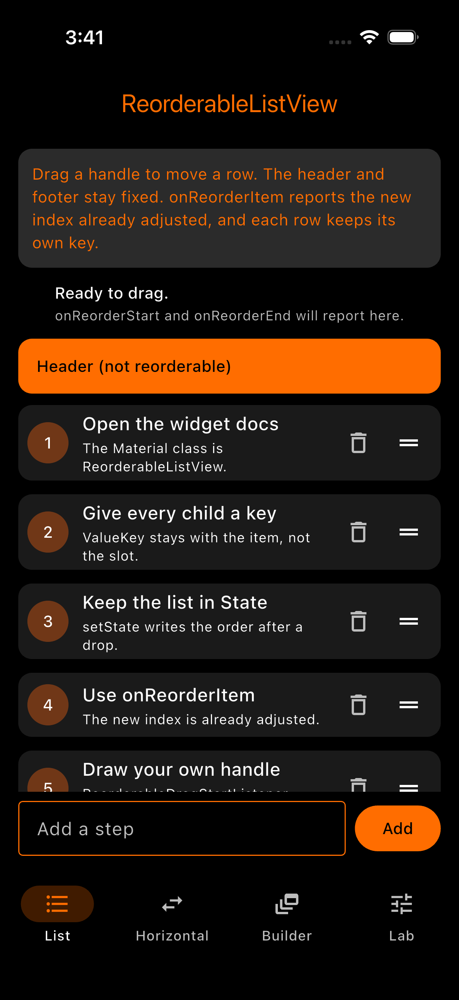

# Wigdet_Presentation_Gilbert_Ntivunwa

Public repo: https://github.com/NTIVUNWA250/Wigdet_Presentation_Gilbert_Ntivunwa

A short Flutter demo of ReorderableListView, in black and orange.

## Run

```bash
flutter pub get
flutter run
```

Pick an iOS simulator, an Android emulator, or Chrome when Flutter asks.

## Attributes

- Widget: Flutter Material ReorderableListView.
- Order changes go through onReorderItem. Flutter marks the older onReorder callback as deprecated, and this demo does not use it.
- The four tabs show drag handles, a fixed header and footer, a drag proxy, a horizontal list, ReorderableListView.builder, and switches for direction, reverse, handles, header, and footer.
- Author: Gilbert Ntivunwa (NTIVUNWA250, g.ntivunwa@alustudent.com).

## Screenshot


